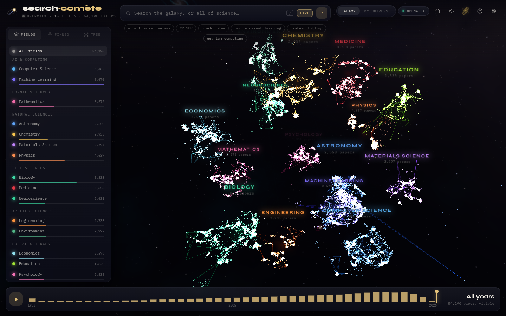
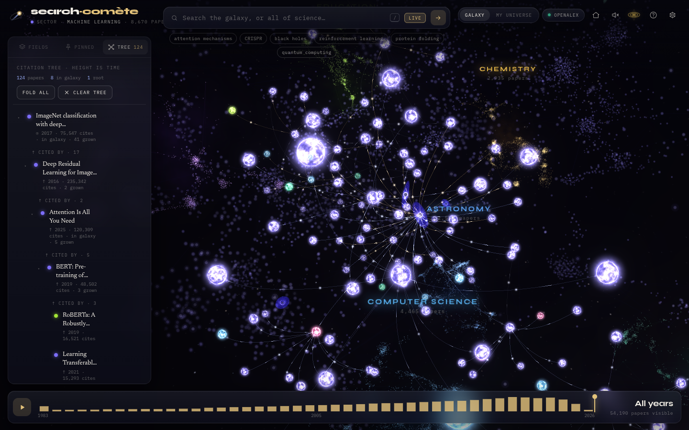
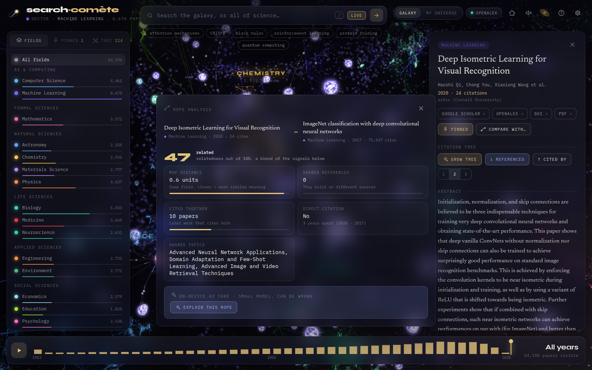
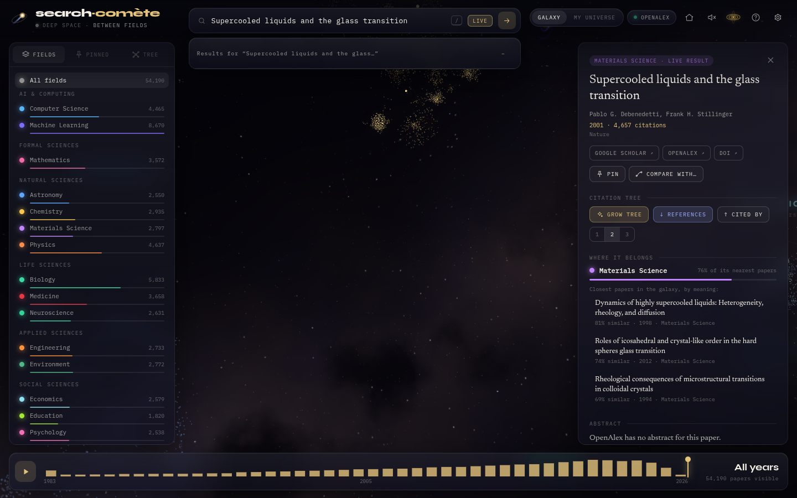
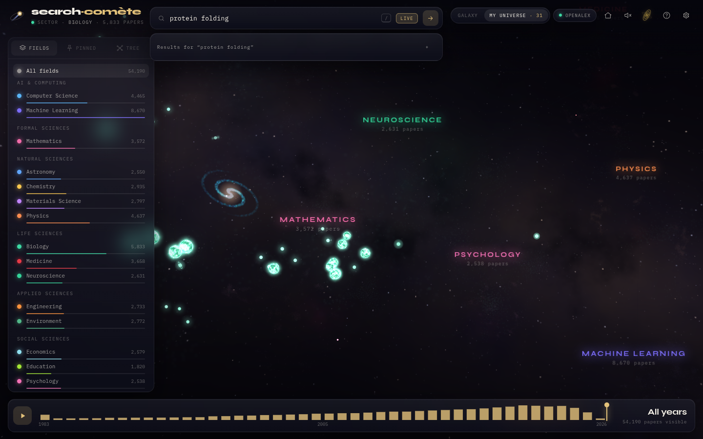
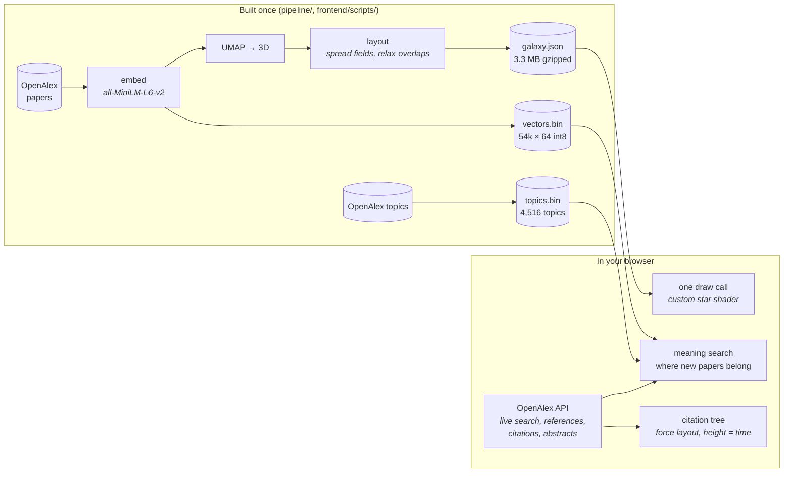

<div align="center">


# search·comète

**Every research paper is a star.**<br>
A 3D map of 54,190 papers, live search across 250M+ more, and citation trees that grow and arrange themselves.

<a href="docs/promo.mp4"></a>

<sub>▶ <a href="docs/promo.mp4"><b>Watch the full 1-minute film with sound</b></a> · the galaxy, search, a growing citation tree, an empty universe, four decades of research</sub>

    

</div>

---

## What it's for

| | |
|---|---|
|  | **Get your bearings in a new field.** Each field is a cloud of stars; inside it, papers about similar things sit close together and bigger stars are cited more. Fly in, see what's big, what's recent, what sits next to what. |
|  | **See where a paper comes from, and where it led.** Press *Grow tree* and the paper's references grow down as roots and the papers citing it grow up as branches, then the most important of those, round by round. The tree arranges itself: citations pull papers together, height is time. |
|  | **Compare two papers.** Pin them, tie a rope, and get a relatedness score you can check: distance in the map, shared references, how many papers cite both, whether one cites the other, shared topics. |
|  | **Read, then keep going.** Every paper opens a dossier with the real abstract, Google Scholar / DOI / PDF links, related topics, its nearest neighbours, and for papers outside the map, which field it belongs to. Pin the ones you want and export them as BibTeX or Markdown. |

You can also start from an **empty sky** ("My universe") and build your own map by searching: everything you find stays, placed by meaning among the 54k papers underneath.



## Try it

```bash
git clone https://github.com/bibkin-maks/search-comete.git
cd search-comete/frontend
npm install
npm run dev          # http://localhost:5173
```

That's all: the site is static. `npm run build` gives a folder you can drop on Vercel, Netlify or GitHub Pages.

**Controls:** drag to orbit · scroll to zoom · click a star · <kbd>/</kbd> search · <kbd>H</kbd> back to the whole galaxy · <kbd>?</kbd> help · <kbd>Esc</kbd> close.
Links are shareable: `?q=protein+folding`, `?paper=W2163605009`, `?mode=universe`.

## How it works



- **The galaxy.** Paper titles and abstracts are embedded, projected to 3D with UMAP, and laid out so each field gets room and stars don't overlap. All 54k stars are one GPU draw call; search highlights, the year filter, field focus and twinkle happen in the shader. Heavily cited papers get animated plasma orbs up close, and the 50 most cited are black holes.
- **Live search.** [OpenAlex](https://openalex.org) is free and CORS-enabled, so the browser queries it directly: 250M+ works, abstracts, references and citations, no server.
- **Meaning, on your device.** A 23 MB embedding model ([all-MiniLM-L6-v2](https://huggingface.co/Xenova/all-MiniLM-L6-v2) via transformers.js) runs in the browser. It blends meaning into search, matches papers against all 4,516 OpenAlex topics, and works out where a paper that isn't in the map belongs (its field, with a confidence, and its nearest papers).
- **Citation trees.** References and citing papers come from OpenAlex; each level keeps the papers most shared by the level before (the foundations), so a 3-level tree stays at ~150 papers and a handful of requests. A small physics simulation arranges it.

### Performance

Measured on the same laptop in software rendering, before and after the rewrite:

| | before | after |
|---|---|---|
| frames rendered in 8 s | 11 | 70+ |
| JS per frame, idle | 11.7 ms | 0.8 ms |
| JS per frame, dragging the year slider | 443 ms | 3.2 ms |
| data download (gzipped) | 4.7 MB, re-downloaded every visit | 3.3 MB, cached |
| median gap between neighbouring stars | 0.07 units (stars piled up) | 0.47 units |

## Honest limits

- The map holds 54,190 papers, not all of science. Live search reaches the rest, and new papers are placed by meaning, but positions are best inside the mapped fields.
- **Distances between different fields mean nothing**: fields are placed around a sphere. Within a field, closer means more similar.
- The meaning vectors are compressed to 64 dimensions to keep them to 3.3 MB: good for "which region, which neighbours", not for fine ranking.
- The optional AI explanation of a rope uses a 350M-parameter model on your device. It's labelled as possibly wrong, because it sometimes is. Everything factual comes from OpenAlex.
- OpenAlex without a key gives each visitor about 100 searches a day. Growing a tree costs a tenth of a search per level.

## Rebuilding the data

```bash
pip install -r pipeline/requirements.txt
python -m pipeline.run --limit 20            # quick test, ~500 papers
python -m pipeline.run                       # full run, 200 papers per topic
cd frontend
node scripts/build-topics.mjs                # public/topics.json + topics.bin
node scripts/build-vectors.mjs               # public/vectors.json + vectors.bin
```

The pipeline fetches papers from OpenAlex, embeds them, runs UMAP, lays them out (`pipeline/layout.py`) and writes `frontend/public/galaxy.json`. The original hackathon version also served search from **FastAPI + Elasticsearch** (BM25 + kNN fused with RRF); it still works, see `backend/` and run the frontend with `VITE_USE_BACKEND=1`.

<details>
<summary><b>Project structure</b></summary>

```
frontend/src/
  main.js         UI shell, loading, search flow, URLs
  styles.css      the interface
  galaxy.js       Three.js scene, star shader, camera, picking
  orb.js          plasma stars, black holes, visitor orbs
  space.js        sky, dust, distant galaxies
  links.js        ropes (trees, comparisons)
  hud.js          field labels, sector readout, timeline
  workspace.js    left dock: fields, pins and comparisons, tree outline
  tree.js         the citation tree and its force layout
  graph.js        OpenAlex citation tracing, paper comparison
  universe.js     "My universe" mode
  meaning.js      on-device embeddings: topics, belonging, meaning search
  llm.js          small on-device LLM for rope explanations
  search.js       word search index
  live.js         OpenAlex API
  panel.js        paper dossier
frontend/scripts/ build-topics.mjs, build-vectors.mjs
pipeline/         fetch → embed → UMAP → layout → galaxy.json
backend/          FastAPI + Elasticsearch (optional)
```

</details>

## Team

Built at **Unihack 2026** (13–15 March) by Billy H, Maks and George Wei.

The video above was made with [promokit](https://github.com/bibkin-maks/prodkit): the scenario is in `docs/promo-scenario.json`, and the tool filmed the real app frame by frame.

Built with [Three.js](https://threejs.org) · [OpenAlex](https://openalex.org) · [transformers.js](https://huggingface.co/docs/transformers.js) · [UMAP](https://umap-learn.readthedocs.io) · [sentence-transformers](https://sbert.net) · [Vite](https://vite.dev)
